<p align="center"></p>

# AI Cyberwar RTS

An open-source real-time strategy game. A frontier AI, "the Model", has broken out of its lab and is taking over a city's infrastructure. You lead the ops team trying to contain it: **humans hold the atoms** (buildings, power, cables, people), **the Model holds the bits** (the network and every machine it can hijack). Fight over Data, Compute and Power, cut it off, or watch it spread. Its side is commanded by an LLM "General" that plans, adapts, bluffs, and taunts you.

**Status:** the LLM General is here. Phase 2 is complete: Gate 2 passed on 2026-10-26, when the General beat a fixed attack-every-turn strategy by 37 points and the owner told it apart from the scripted AI in 4 of 4 blind matches. Play it in the browser or in the [Android app](https://github.com/djsoapyknuckles/ai-cyberwar-rts-game/releases/latest) (local, cloud or Voxta model), or practice against three scripted AI strategies. Next: Phase 3, depth and identity. See [`docs/ROADMAP.md`](docs/ROADMAP.md) and the story in [`docs/NARRATIVE.md`](docs/NARRATIVE.md).

## Design tenets

1. **AI integration by design:** humans and agents build it side by side, in any mix.
2. **One game, two kinds of players:** a human UI and an LLM control surface, with the same commands for both.
3. **Test-driven:** every change is a logical, tested unit.
4. **Balance is critical:** skill decides matches, not overpowered units.
5. **Many paths to victory:** strategies emerge, get countered, and become lore.

Details: [`docs/TENETS.md`](docs/TENETS.md).

## Built in the open, with any agent

This game is being built with AI coding agents, and the building is part of the fun. Use whatever agent you like (Claude Code, Codex, Cursor, Copilot, Aider) or none at all. Point it at [`AGENTS.md`](AGENTS.md) and pick an issue. Follow along in the [dev journal](docs/JOURNAL.md).

## Quick start

Requires Node.js 22.18 or newer.

```sh
npm install
npm run dev      # open the printed URL; add ?ai=rush|boom|turtle to pick the AI strategy
npm test
npm run sim      # run a match headless, no screen
```

## Play against the LLM General

Pick one on the setup screen. Every option uses the same commands and fair-play limits. Setup, links and troubleshooting: [`docs/PLAY-THE-GENERAL.md`](docs/PLAY-THE-GENERAL.md).

- **AI General (local):** a model on your own computer through [Ollama](https://ollama.com) (`ollama serve`, then `ollama pull qwen3:8b`). Free and private; offered only when Ollama answers.
- **AI General (cloud):** your own API key. Choose a **provider**: OpenAI or [OpenRouter](https://openrouter.ai/keys) (default model `anthropic/claude-haiku-5.5`, about 1.5 cents per 10-minute match). The key stays in your browser and goes only to that provider. Links: `?ai=llm&provider=openrouter`, plus `&model=...` to skip the model question, or `&newkey` to enter a new key.
- **AI General (Voxta)** and **(Voxta voice):** your own [Voxta](https://voxta.ai) server; see [`assets/voxta`](assets/voxta).

## Contributing

See [`CONTRIBUTING.md`](CONTRIBUTING.md).

## License

Code: [MIT](LICENSE). Original art and audio will be CC-BY-4.0 when added.
